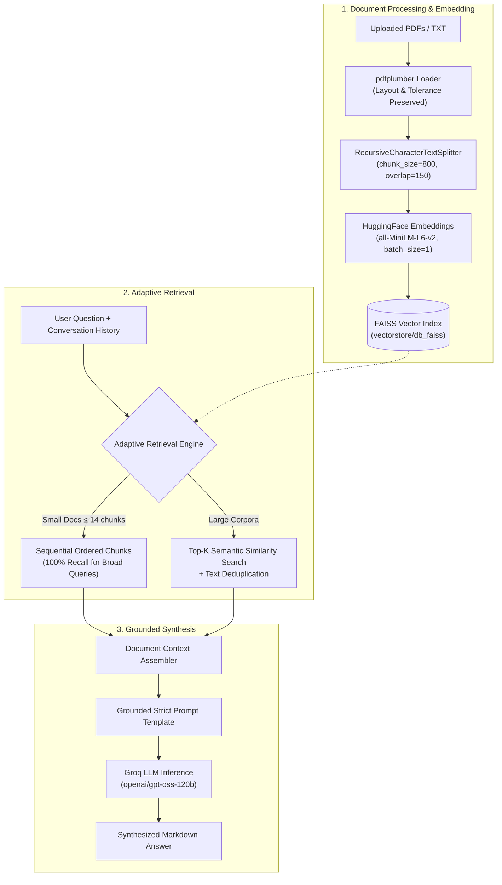

# 🔍 Retrieva — Intelligent Document Intelligence & RAG Platform

<p align="center">
  <strong>Retrieve. Understand. Answer.</strong><br>
  A high-performance, enterprise-grade Retrieval-Augmented Generation (RAG) platform designed for multi-document intelligence, adaptive semantic search, and deep contextual synthesis.
</p>

<p align="center">
  <a href="https://retrieva-hazel.vercel.app"></a>
  
  
  
  
  
  
  
  
</p>

---

## 🌐 Live Deployments

| Component | Platform | Status | URL |
| :--- | :--- | :--- | :--- |
| **Frontend UI** | Vercel | 🟢 Production | [retrieva-hazel.vercel.app](https://retrieva-hazel.vercel.app) |
| **Backend API** | Render | 🟢 Production | [retrieva-backend.onrender.com](https://retrieva-backend.onrender.com) |

---

## 🌟 Executive Summary

**Retrieva** is a modern document intelligence system that transforms unstructured documents (PDFs, reports, research papers, resumes, and legal contracts) into actionable, conversational knowledge. 

Traditional language models suffer from hallucinations and knowledge cutoffs when asked about dense or private files. Retrieva solves this with an **adaptive RAG pipeline** backed by local vector embeddings, smart document chunking, low-resource memory optimizations, and ultra-fast inference through **Groq**. 

Every generated answer is anchored to verified source documents for transparent and trustworthy answers.

---

## ⚡ Key Features

### 1. 📂 Multi-Document Corpus Ingestion & Drag-and-Drop
- Upload single or multiple PDFs through a clean drag-and-drop workspace interface.
- High-fidelity layout parsing via `pdfplumber` with custom layout and character tolerance settings (`x_tolerance: 1.5`) to preserve tables, indentations, and column alignments.
- Automatically maintains an active corpus library with real-time file counters and single-click deletion.

### 2. ⏳ Real-Time Vectorization Loading Screen
- Animated glassmorphic modal with pulsing GPU/CPU chip iconography and shimmering progress indicators.
- Live 4-stage pipeline tracker showing exact progress:
  1. **Ingestion & Upload:** Transferring file(s) to RAG corpus engine
  2. **Layout & Text Extraction:** Parsing pages & preserving tables with `pdfplumber`
  3. **Semantic Embeddings:** Generating vectors with `all-MiniLM-L6-v2`
  4. **FAISS Vector Index:** Building similarity index & preparing Q&A
- Dynamic filename badges displaying active documents being vectorized.

### 3. 🧠 Adaptive Dual-Mode Retrieval
Unlike basic RAG setups that blindly return fixed `top-k` snippets, Retrieva incorporates an **Adaptive Retrieval Engine**:
- **Compact & Dense Documents (e.g., Resumes, Short Reports ≤ 14 chunks):**  
  Retrieves 100% of active chunks in exact sequential reading order (sorted by file name, page number, and text index). This guarantees **100% recall** for broad queries such as *"List all technical projects"*, *"What are all the candidate's skills?"*, or *"Summarize work history"*, eliminating missing bullet points caused by embedding similarity cutoffs.
- **Large & Multi-Page Corpora:**  
  Executes high-dimensional semantic search over FAISS index vectors, applying text deduplication to extract the most relevant passages without redundant overlap.

### 4. 🎯 Grounded Synthesis & Hallucination Resistance
- Specialized grounding prompt template enforcing strict contextual boundary discipline.
- Prevents cross-contamination between distinct document sections (e.g., project descriptions only list technologies explicitly mentioned in that project's scope, rather than borrowing from a generic skills section).
- Formats structured answers using clean Markdown with tables, bullet lists, and section headers.

### 5. 📊 Exportable PDF Analysis Reports
- Generate formatted PDF reports summarizing the entire conversation history, query prompts, and AI answers with a single click.
- Built with `ReportLab` featuring custom headers, source document stamps, date-time tracking, pagination, and multi-page text formatting.

### 6. 🛡️ Cloud & Free-Tier Memory Optimizations
- **Thread Control:** Configured `OMP_NUM_THREADS=1` and `MKL_NUM_THREADS=1` to prevent PyTorch from allocating multiple 64MB memory pools.
- **Sequential Chunk Encoding:** Set `batch_size=1` during embedding generation to eliminate memory spikes on 512MB RAM cloud tiers.
- **Non-Blocking Async Threads:** CPU-heavy vectorization and LLM synthesis are offloaded via `asyncio.to_thread` to ensure the FastAPI event loop never blocks or triggers 502 gateway timeouts.
- **Lean Dependency Footprint:** Stripped unused scientific packages to reduce Docker/build image footprint by >70%.

---

## 🏗️ System Architecture



---

## 🛠️ Technology Stack

| Layer | Technology | Purpose |
| :--- | :--- | :--- |
| **Frontend UI** | [React 19](https://react.dev/) + [Vite 6](https://vite.dev/) | High-performance, responsive single-page application |
| **Styling & Icons** | Vanilla CSS + [Lucide React](https://lucide.dev/) | Clean typography, dark accents, and animated glassmorphic modals |
| **Markdown Rendering** | [Marked](https://marked.js.org/) | Renders rich AI synthesis with tables, code, and lists |
| **Backend API** | [FastAPI](https://fastapi.tiangolo.com/) + [Uvicorn](https://www.uvicorn.org/) | Non-blocking asynchronous REST API with CORS support |
| **RAG Orchestration** | [LangChain](https://www.langchain.com/) | Prompt chaining, memory, and retrieval orchestration |
| **LLM Inference** | [Groq](https://groq.com/) (`openai/gpt-oss-120b`) | Ultra-fast generative inference on open models |
| **Embeddings** | `all-MiniLM-L6-v2` ([HuggingFace](https://huggingface.co/)) | 384-dimensional dense semantic representations |
| **Vector Database** | [FAISS](https://github.com/facebookresearch/faiss) | In-memory and disk-persisted vector similarity search |
| **Document Parser** | [pdfplumber](https://github.com/jsvine/pdfplumber) | High-fidelity text, table, and bounding-box extraction |
| **Report Generation** | [ReportLab](https://www.reportlab.com/) | Programmatic PDF summary report generation |
| **Cloud Hosting** | [Vercel](https://vercel.com/) + [Render](https://render.com/) | 100% Free decoupled cloud hosting |

---

## 📁 Repository Structure

```plaintext
Retrieva/
├── api.py                    # FastAPI application & REST endpoints (/upload, /chat, /documents, /clear, /health)
├── rag_pipeline.py           # LangChain RAG pipeline, strict prompt template & ReportLab PDF generator
├── vector_database.py        # PDF extraction, chunking, adaptive retrieval & FAISS vectorstore management
├── requirements.txt          # Lean Python backend dependencies (optimized for 512MB RAM)
├── render.yaml               # Render Cloud deployment blueprint
├── Dockerfile                # Multi-stage containerization build
├── .env.example              # Environment variable template
├── pdfs/                     # Storage directory for uploaded corpus documents
├── vectorstore/              # Persistent FAISS vector database indices
│   └── db_faiss/
└── frontend/                 # React 19 + Vite web application
    ├── index.html            # Web application entry point
    ├── package.json          # Frontend packages & scripts
    ├── vercel.json           # Vercel SPA client rewrite rules
    ├── vite.config.js        # Vite build configuration
    └── src/
        ├── App.jsx           # Main Retrieva dashboard, modal loader, sidebar & chat interface
        ├── App.css           # Workspace, loading modal animations, and chat layout styling
        ├── index.css         # Global design tokens, typography, and markdown styling
        └── main.jsx          # React DOM root mounting
```

---

## 🚀 Local Development Setup

### Prerequisites
- **Python 3.10+**
- **Node.js 18+** & **npm**
- **Groq API Key:** Get a free key from [Groq Console](https://console.groq.com/keys)

---

### 1. Backend Setup

1. **Clone the repository:**
   ```bash
   git clone https://github.com/chanchalanharsh18/Retrieva.git
   cd Retrieva
   ```

2. **Create and activate a virtual environment:**
   ```bash
   # Windows (PowerShell / Command Prompt):
   python -m venv venv
   venv\Scripts\activate

   # macOS / Linux:
   python3 -m venv venv
   source venv/bin/activate
   ```

3. **Install dependencies:**
   ```bash
   pip install --no-cache-dir torch --index-url https://download.pytorch.org/whl/cpu
   pip install -r requirements.txt
   ```

4. **Configure environment variables:**  
   Create a `.env` file in the `Retrieva/` directory:
   ```env
   GROQ_API_KEY=gsk_your_groq_api_key_here
   ```

5. **Start the FastAPI backend:**
   ```bash
   uvicorn api:app --reload --port 8000
   ```
   The backend will be live at `http://localhost:8000`.  
   Interactive API docs (Swagger UI) are available at `http://localhost:8000/docs`.

---

### 2. Frontend Setup

1. **Open a new terminal and navigate to the frontend folder:**
   ```bash
   cd Retrieva/frontend
   ```

2. **Install frontend dependencies:**
   ```bash
   npm install
   ```

3. **Launch the development server:**
   ```bash
   npm run dev
   ```

4. **Open your browser:**
   ```
   http://localhost:5173
   ```

---

## ☁️ Free Cloud Deployment Guide

Retrieva is architected to run **100% for free** without paying for compute or servers:

### Option A: Decoupled (Vercel Frontend + Render Backend)

#### 1. Backend on Render (Free Python Web Service)
1. Go to [render.com](https://render.com) and create a **New Web Service** connected to your GitHub repo.
2. Settings:
   - **Runtime:** `Python 3`
   - **Build Command:**
     ```bash
     pip install --no-cache-dir torch --index-url https://download.pytorch.org/whl/cpu && pip install --no-cache-dir -r requirements.txt
     ```
   - **Start Command:**
     ```bash
     uvicorn api:app --host 0.0.0.0 --port $PORT --timeout-keep-alive 75
     ```
   - **Instance Type:** `Free`
3. Environment Variables:
   - `GROQ_API_KEY` = `your_groq_api_key`
   - `PYTHON_VERSION` = `3.11.0`
   - `MALLOC_TRIM_THRESHOLD_` = `100000`
   - `OMP_NUM_THREADS` = `1`
   - `MKL_NUM_THREADS` = `1`
4. Deploy and copy your backend URL (`https://retrieva-backend.onrender.com`).

#### 2. Frontend on Vercel
1. Go to [vercel.com](https://vercel.com) and click **Add New Project**.
2. Select your repository:
   - **Root Directory:** `frontend`
   - **Framework Preset:** `Vite`
3. Environment Variables:
   - `VITE_API_BASE_URL` = `https://retrieva-backend.onrender.com`
4. Deploy to get your live production link (`https://retrieva-hazel.vercel.app`).

---

## 🔌 API Reference

### `GET /`
Root health check endpoint.
- **Response:**
  ```json
  {
    "status": "ok",
    "service": "Retrieva API",
    "online": true
  }
  ```

---

### `GET /health`
Liveness probe for cloud orchestrators and monitoring tools.
- **Response:**
  ```json
  {
    "status": "healthy"
  }
  ```

---

### `GET /documents`
Retrieves all documents currently indexed in the active corpus library.
- **Response:**
  ```json
  {
    "filenames": ["quarterly_report.pdf", "resume.pdf"]
  }
  ```

---

### `POST /upload`
Uploads, chunks, embeds, and indexes one or more documents into the FAISS vector database.
- **Content-Type:** `multipart/form-data`
- **Body:** `files`: List of files (`.pdf`, `.txt`)
- **Response:**
  ```json
  {
    "message": "Successfully indexed 1 document(s)",
    "filenames": ["quarterly_report.pdf"]
  }
  ```

---

### `POST /chat`
Executes an adaptive, grounded RAG query against active documents with multi-turn conversation memory.
- **Content-Type:** `application/x-www-form-urlencoded`
- **Body Parameters:**
  - `query` *(string, required)*: The user's question.
  - `history` *(string, optional)*: Formatted conversation history.
- **Response:**
  ```json
  {
    "response": "According to the financial statement on page 4, gross margin increased by 14% year-over-year...",
    "sources": [
      {
        "file": "quarterly_report.pdf",
        "page": 4
      }
    ]
  }
  ```

---

### `POST /delete-document`
Removes a specific document from the library and re-indexes remaining files.
- **Content-Type:** `application/x-www-form-urlencoded`
- **Body:** `filename=quarterly_report.pdf`
- **Response:**
  ```json
  {
    "message": "Deleted quarterly_report.pdf",
    "filenames": []
  }
  ```

---

### `POST /clear`
Clears all documents from the library, resets the FAISS vector database, and wipes stored files.
- **Response:**
  ```json
  {
    "message": "Session cleared",
    "filenames": []
  }
  ```

---

### `POST /export-report`
Generates and downloads a publication-ready PDF report of the active conversation.
- **Content-Type:** `application/json`
- **Body:**
  ```json
  {
    "messages": [
      { "role": "user", "content": "What are the candidate's core projects?" },
      { "role": "assistant", "content": "The candidate has worked on..." }
    ]
  }
  ```
- **Response:** PDF file download (`application/pdf`, filename: `Retrieva_Analysis_Report.pdf`)

---

## 💼 Real-World Use Cases

- **📄 Resume & Candidate Screening:** Parse candidate resumes and ask complex queries (*"List every project with React in the candidate's career and their specific achievements"*) without missing sections.
- **📑 Legal & Policy Audit:** Interrogate dense contracts, NDAs, and SLAs to locate key clauses, indemnities, and termination terms.
- **📊 Financial & Research Reports:** Ingest multi-page annual reports, earnings transcripts, or research papers and extract data backed by verifiable context.
- **📚 Technical Documentation Assistant:** Transform technical manuals, SDK guides, and architecture specifications into a 24/7 conversational assistant.

---

## 📄 License

Distributed under the **MIT License**. See `LICENSE` for more information.
