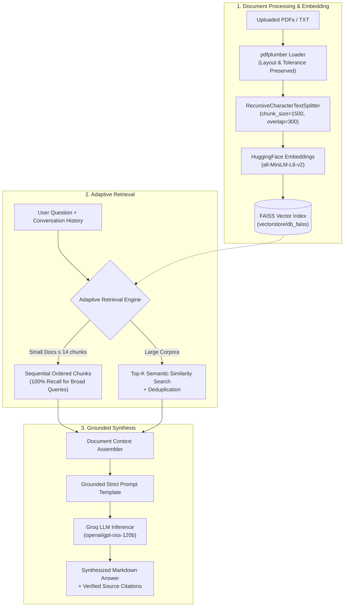

# 🔍 Retrieva — Intelligent Document Intelligence & RAG Platform

<p align="center">
  <strong>Retrieve. Understand. Answer.</strong><br>
  A high-performance, enterprise-ready Retrieval-Augmented Generation (RAG) platform designed for multi-document intelligence, adaptive semantic search, deep contextual synthesis, and verified source citations.
</p>

<p align="center">
  
  
  
  
  
  
  
  
</p>

---

## 🌟 Executive Summary

**Retrieva** is a modern document intelligence system that transforms unstructured documents (PDFs, reports, research papers, resumes, and text files) into actionable, conversational knowledge. 

Traditional language models suffer from knowledge cutoffs and hallucinations when queried about private or dense documents. Retrieva solves this with an **adaptive RAG pipeline** backed by local vector embeddings, smart document chunking, and ultra-fast inference through **Groq**. 

Every generated answer is anchored to verified source documents, delivering page-level citations for transparent and trustworthy answers.

---

## ⚡ What Retrieva Can Do

Retrieva is engineered for high-accuracy document exploration. Here are its core capabilities:

### 1. 📂 Multi-Document Corpus Ingestion
- Upload multiple PDFs simultaneously through a modern drag-and-drop web interface.
- Files are parsed page-by-page using `pdfplumber` with custom layout and character tolerance settings (`x_tolerance: 1.5`) to preserve tables, indentations, and column alignments.
- Automatically organizes files into a persistent corpus library with real-time file counts.

### 2. 🧠 Adaptive Dual-Mode Retrieval
Unlike basic RAG setups that blindly return `top-k` snippets, Retrieva incorporates an **Adaptive Retrieval Engine**:
- **Compact & Dense Documents (e.g., Resumes, Short Reports ≤ 14 chunks):**  
  Retrieves 100% of active chunks in exact sequential reading order (sorted by file name, page number, and text index). This guarantees **100% recall** for broad inquiries such as *"List all technical projects"*, *"What are all the candidate's skills?"*, or *"Summarize work history"*, eliminating missing bullet points caused by embedding similarity cutoffs.
- **Large & Multi-Page Corpora:**  
  Executes high-dimensional semantic search over FAISS index vectors, applying text deduplication to extract the most relevant passages without redundant overlap.

### 3. 🎯 Hallucination-Resistant Synthesis
- Engineered with a specialized grounding prompt template that enforces strict contextual boundary discipline.
- Prevents cross-contamination between distinct document sections (e.g., ensures project descriptions only list technologies explicitly mentioned in that project's scope, rather than borrowing from a generic skills section).
- Formats structured answers using clean Markdown with tables, bullet lists, and section headers.

### 4. 📌 Verified Page & File-Level Citations
- Every AI response includes clickable source badges showing the **source document name** and **exact page number** (`p. X`).
- Instantly verify where specific facts, statistics, or clauses originated from within the original documents.

### 5. 💬 Multi-Turn Conversational Memory
- Maintains a conversational sliding window history across interactions.
- Allows natural follow-up queries (e.g., *"Can you elaborate on the second project?"* or *"Compare that with the first document"*).

### 6. 🛠️ Complete Document Lifecycle Management
- **Individual File Deletion:** Remove any document from the corpus with a single click. The vector store automatically cleans and re-indexes remaining files.
- **Session Reset:** Clear the entire library and wipe the vector cache to start a completely fresh session.
- **Persistent State:** Existing documents and embeddings are safely stored locally across backend restarts.

### 7. 📊 Exportable PDF Analysis Reports
- Generate beautifully formatted PDF reports summarizing the entire conversation history, query prompts, and AI answers with a single click.
- Built with `ReportLab` featuring custom headers, source document stamps, date-time tracking, pagination, and multi-page text formatting.

---

## 🏗️ System Architecture



---

## 🛠️ Technology Stack

| Layer | Technology | Purpose |
| :--- | :--- | :--- |
| **Frontend UI** | [React 19](https://react.dev/) + [Vite](https://vite.dev/) | Ultra-responsive, modern single-page dashboard |
| **Icons & Design** | [Lucide React](https://lucide.dev/) | Clean, accessible SVG iconography |
| **Markdown Rendering** | [Marked](https://marked.js.org/) | Renders rich AI synthesis with tables, code, and lists |
| **Backend API** | [FastAPI](https://fastapi.tiangolo.com/) + [Uvicorn](https://www.uvicorn.org/) | Async, high-throughput REST API with CORS support |
| **RAG Orchestration** | [LangChain](https://www.langchain.com/) | Prompt chaining, memory, and retrieval orchestration |
| **LLM Inference** | [Groq](https://groq.com/) (`openai/gpt-oss-120b`) | Sub-second generative inference on open models |
| **Embeddings** | `all-MiniLM-L6-v2` ([HuggingFace](https://huggingface.co/)) | 384-dimensional dense semantic representations |
| **Vector Database** | [FAISS](https://github.com/facebookresearch/faiss) | Blazing-fast in-memory and disk-persisted vector similarity search |
| **Document Parser** | [pdfplumber](https://github.com/jsvine/pdfplumber) | High-fidelity text, table, and bounding-box extraction |
| **Report Generation** | [ReportLab](https://www.reportlab.com/) | Programmatic PDF summary report generation |

---

## 📁 Repository Structure

```plaintext
Retrieva/
├── api.py                    # FastAPI application & REST endpoints (/upload, /chat, /documents, /clear)
├── rag_pipeline.py           # LangChain RAG pipeline, strict prompt template & ReportLab PDF generator
├── vector_database.py        # PDF extraction, chunking, adaptive retrieval & FAISS vectorstore management
├── requirements.txt          # Python backend dependencies
├── .env                      # Environment configuration (GROQ_API_KEY)
├── pdfs/                     # Local storage directory for uploaded corpus documents
├── vectorstore/              # Persistent FAISS vector database indices
│   └── db_faiss/
└── frontend/                 # React 19 + Vite web application
    ├── index.html            # Web application entry point
    ├── package.json          # Frontend packages & scripts
    ├── vite.config.js        # Vite build configuration
    └── src/
        ├── App.jsx           # Main Retrieva dashboard, corpus sidebar & chat interface
        ├── App.css           # Workspace, sidebar, and chat layout styling
        ├── index.css         # Global design tokens, typography, and markdown stylesheet
        └── main.jsx          # React DOM root mounting
```

---

## 🚀 Quickstart Guide

### Prerequisites
- **Python 3.10+**
- **Node.js 18+** & **npm**
- **Groq API Key:** Get a free key from [Groq Console](https://console.groq.com/keys)

---

### 1. Backend Setup

1. **Clone the repository and enter the directory:**
   ```bash
   git clone https://github.com/your-username/Retrieva.git
   cd Retrieva
   ```

2. **Create and activate a virtual environment:**
   ```bash
   # Windows (PowerShell / Command Prompt):
   python -m venv venv
   venv\Scripts\activate

   # macOS / Linux:
   python3 -m venv venv
   source venv/bin/activate
   ```

3. **Install dependencies:**
   ```bash
   pip install -r requirements.txt
   ```

4. **Configure environment variables:**  
   Create a `.env` file in the `Retrieva/` root directory:
   ```env
   GROQ_API_KEY=gsk_your_groq_api_key_here
   ```

5. **Start the FastAPI backend:**
   ```bash
   uvicorn api:app --reload --port 8000
   ```
   The backend will be live at `http://localhost:8000`.  
   Interactive API docs (Swagger UI) are accessible at `http://localhost:8000/docs`.

---

### 2. Frontend Setup

1. **Open a new terminal and navigate to the frontend folder:**
   ```bash
   cd Retrieva/frontend
   ```

2. **Install frontend dependencies:**
   ```bash
   npm install
   ```

3. **Launch the development server:**
   ```bash
   npm run dev
   ```

4. **Open your browser:**
   ```
   http://localhost:5173
   ```

---

## 🔌 API Reference

### `GET /documents`
Retrieves all documents currently indexed in the active corpus library.
- **Response:**
  ```json
  {
    "filenames": ["quarterly_report.pdf", "user_manual.pdf"]
  }
  ```

---

### `POST /upload`
Uploads and indexes one or more documents into the FAISS vector database.
- **Content-Type:** `multipart/form-data`
- **Body:** `files`: List of files (`.pdf`, `.txt`)
- **Response:**
  ```json
  {
    "message": "Successfully indexed 1 document(s)",
    "filenames": ["quarterly_report.pdf"]
  }
  ```

---

### `POST /chat`
Executes an grounded RAG query against active documents with conversational history.
- **Content-Type:** `application/x-www-form-urlencoded`
- **Body Parameters:**
  - `query` *(string, required)*: The user's prompt or question.
  - `history` *(string, optional)*: Formatted conversation history for multi-turn continuity.
- **Response:**
  ```json
  {
    "response": "According to the financial statement on page 4, gross margin increased by 14% year-over-year...",
    "sources": [
      {
        "file": "quarterly_report.pdf",
        "page": 4
      }
    ]
  }
  ```

---

### `POST /delete-document`
Removes a specific document from the library and re-indexes remaining files.
- **Content-Type:** `application/x-www-form-urlencoded`
- **Body:** `filename=quarterly_report.pdf`
- **Response:**
  ```json
  {
    "message": "Deleted quarterly_report.pdf",
    "filenames": []
  }
  ```

---

### `POST /clear`
Clears all documents from the library, resets the FAISS vector database, and wipes stored files.
- **Response:**
  ```json
  {
    "message": "Session cleared",
    "filenames": []
  }
  ```

---

### `POST /export-report`
Generates and downloads a formatted, publication-ready PDF report of the active conversation.
- **Content-Type:** `application/json`
- **Body:**
  ```json
  {
    "messages": [
      { "role": "user", "content": "What are the candidate's core projects?" },
      { "role": "assistant", "content": "The candidate has worked on..." }
    ]
  }
  ```
- **Response:** PDF file download (`application/pdf`, filename: `Retrieva_Analysis_Report.pdf`)

---

## 💼 Real-World Use Cases

- **📄 Resume & Candidate Screening:** Parse candidate resumes and ask complex queries (*"List every project with React in the candidate's career and their specific achievements"*) without missing sections.
- **📑 Legal & Policy Audit:** Interrogate dense contracts, NDAs, and SLAs to locate key clauses, indemnities, and termination terms with verified page citations.
- **📊 Financial & Research Reports:** Ingest multi-page annual reports, earnings transcripts, or research papers and extract data backed by verifiable citations.
- **📚 Technical Documentation Assistant:** Transform technical manuals, SDK guides, and architecture specifications into a 24/7 conversational assistant.

---

## 🤝 Contributing

Contributions, issues, and feature requests are welcome!  
Feel free to open an issue or submit a pull request:

1. Fork the Project
2. Create your Feature Branch (`git checkout -b feature/AmazingFeature`)
3. Commit your Changes (`git commit -m 'Add some AmazingFeature'`)
4. Push to the Branch (`git push origin feature/AmazingFeature`)
5. Open a Pull Request

---

## 📄 License

Distributed under the **MIT License**. See `LICENSE` for more information.
